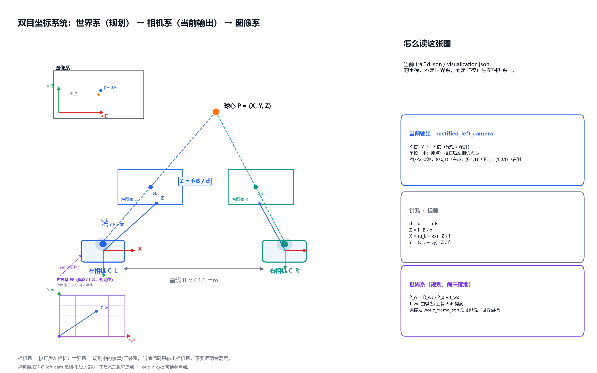

# 数据标准（双目会话 / 标准轨迹 / 可视化数据）

> 目标：一次采集的结果，不依赖日志、不靠人记坐标，任何人拿到会话目录就能：
> ① 知道球心 seed；② 读三维轨迹；③ 直接喂给可视化程序。
> 预测数据**暂时不进入标准**（当前阶段只做检测与三维轨迹）。

---

## 1. 会话目录

```text
data/sessions/<YYYYMMDD-HHMMSS>/
  session.json                采集契约：左右相机、标定快照、同步
  left.mkv  right.mkv         无损原始视频（HFYU）
  left_times.csv  right_times.csv
  calib/stereo_calibration.npz/.json
  derived/
    seeds.json                ← 人工点选/命令行的球心种子
    traj3d.csv                逐帧原始表（调试/兼容）
    traj3d_smoothed.csv       可选：S-G 平滑
    traj3d.json               ★ 标准三维轨迹
    visualization.json        ★ 可视化专用数据
    annotated.mp4             左右并排 + 检测圈 + 轨迹线
    traj3d.png                三维轨迹图
```

`derived/` 里除 `seeds.json` 外都可以重新生成；`session.json` 和视频是原始数据，**不要手改**。

---

## 1.5 `session.json` 的双目模式（2026-10-21 新增）

旧会话没有这些字段 → 按 `parallel` 解释，不需要迁移：

```json
{
  "stereo_mode": "parallel",
  "rig": {
    "stereo_mode": "parallel",
    "angle_deg": 0.3,
    "baseline_mm": 64.595
  }
}
```

- `parallel`：现有校正双目，坐标系 `rectified_left_camera`；
- `angled`：大角度/近似直角，坐标系 `left_camera`（原始左相机）；
- `angle_deg` 由标定 R 计算，**不是手填的 90.0**；
- 标定文件同样可有 `stereo_mode/angle_deg`，旧标定缺省 parallel。

## 2. `seeds.json`

```json
{
  "schema": "sphere-stereo-seeds",
  "version": 1,
  "session": "20261019-221550",
  "created": "2026-10-19 22:44:38",
  "image_size": [1920, 1080],
  "seed_frame": 0,
  "source": "gui_click",
  "note": "GUI 点选球心；半径由点击点附近 Hough 估计",
  "left":  {"x": 1260.0, "y": 830.0, "radius": 65.0},
  "right": {"x": 920.0,  "y": 830.0, "radius": 65.0}
}
```

约定：

- 坐标是**原始视频像素**（不是预览缩放后的坐标）；
- `seed_frame` 必须和左右坐标对应；
- `radius` 是外轮廓半径（金属球内部高光不算）；
- `source`：`gui_click` / `cli` / `manual`；
- 同一个 seed_frame 的左右 seed 必须都来自**同一时刻**。

写入：GUI「点选球（双目 seed）」或 CLI

```powershell
python apps\run_stereo_video.py <session> --method specular ^
  --seed 1260,830,65 --seed-right 920,830,65 --seed-frame 0
```

CLI 会把实际使用的 seed 写回 `derived/seeds.json`，保证可追溯。

---

## 3. `traj3d.csv`（调试/兼容）

```text
frame,t,matched,X,Y,Z,u_left,v_left,u_right,v_right,
epipolar_px,residual_px,confident,method_left,method_right
```

- `matched=1` 时 X/Y/Z/像素/残差才有意义；
- `matched=0` 行可能缺列（历史原因），**不要用列位置硬解析**；标准读取器 `stereo.visualization.read_trajectory_csv` 会补空；
- 单位米；`parallel` 坐标系 `rectified_left_camera`，`angled` 为 `left_camera`。

---

## 4. `traj3d.json`（★ 标准轨迹）

```json
{
  "schema": "sphere-stereo-trajectory",
  "version": 1,
  "session": "20261019-221550",
  "created": "2026-10-19 22:45:24",
  "source_csv": "derived/traj3d.csv",
  "unit": "m",
  "stereo_mode": "parallel",
  "coordinate_system": "rectified_left_camera",
  "image_size": [1920, 1080],
  "sync": {"method": "flash", "offset": 0, "confidence": 0.815},
  "calibration": {"baseline_mm": 64.595, "created": "...", "verdict": "..."},
  "seeds": { "...": "同 seeds.json" },
  "bounds": {"min": [x,y,z], "max": [x,y,z]},
  "n_samples": 301,
  "n_matched": 293,
  "samples": [
    {
      "frame": 0, "t": 0.0, "matched": true,
      "xyz": [0.0958, 0.0584, 0.2536],
      "uv_left": [1260.0, 830.0], "uv_right": [920.0, 830.0],
      "epipolar_px": 5.63, "residual_px": 2.815,
      "confident": true,
      "method_left": "specular", "method_right": "specular"
    }
  ]
}
```

- `samples` 保留**所有帧**（包括 matched=false），可视化只取 matched；
- `bounds` 只由 matched 点算；
- `stereo_mode=parallel` 时 `coordinate_system=rectified_left_camera`；
  `angled` 时为 `left_camera`（原始左相机系，不做立体校正）；
- 没有预测字段。以后加预测必须**升 version**，不能偷偷塞。

---

## 5. `visualization.json`（★ 可视化程序直接读）

```json
{
  "schema": "sphere-stereo-visualization",
  "version": 1,
  "session": "20261019-221550",
  "unit": "m",
  "stereo_mode": "parallel",
  "coordinate_system": "rectified_left_camera",
  "bounds": {"min": [...], "max": [...]},
  "n_points": 293,
  "trajectory": [
    {"frame": 0, "t": 0.0, "xyz": [0.0958, 0.0584, 0.2536], "confident": true}
  ],
  "style": {
    "line_color": "#2563eb", "point_color": "#f97316",
    "background": "#ffffff",
    "axes": {"x": "X right", "y": "Y down", "z": "Z forward"}
  },
  "samples": [...]
}
```

可视化程序**只依赖** `schema/version/unit/stereo_mode/coordinate_system/trajectory/bounds/style`；
`trajectory` 的每个点都有 `xyz`，不需要再解析 CSV。

---

## 6. 坐标系

### parallel（现有）

- 原点：**校正后**左相机光心；
- **X 向右**、**Y 向下**、**Z 向前**；
- 单位米；
- 与 `config/stereo_calibration.*` 的 P1/P2 自洽；
- 视差 `d = u_L - u_R`，深度是 **Z = f·B/d**。

### angled（大角度/近似直角）

- 原点：**原始**左相机光心；
- 不做 `stereoRectify`，X 右 / Y 下 / Z 前；
- 单位米；
- 像素经 K/D 去畸变后变成射线，两条射线做最近点交会；
- 不再使用“校正后 y 差”或单一的 `Z=fB/d`；
- 输出标记 `stereo_mode=angled`、`coordinate_system=left_camera`。

> 两者都**不是世界坐标系**；要转世界系需要棋盘 PnP，另存 `world_frame.json`（尚未实现）。
> 不要把 parallel 的 `xyz` 和 angled 的 `xyz` 混进同一条轨迹。



图里左侧是世界系（棋盘/工装，规划中）到左相机的 `T_wc`，中间是左右相机与基线 `B`，
右侧是当前 `traj3d.json` 实际使用的相机系：**X 右 / Y 下 / Z 前**。
`O left-cam` 视频叠加的是相机光心投影，不是世界原点。

---

## 7. 生成与校验

```powershell
# 生成标准 JSON（也可在 run_stereo_video 全片跑完后自动生成）
python apps\export_visualization.py data\sessions\20261019-221550 --plot

# 校验
python apps\tools\check_dataset.py data\sessions\20261019-221550
python tests\selftest_stereo_pipeline.py
```

版本规则：

- 加字段 → 保持 version，读取方忽略未知字段；
- 改字段语义/坐标轴/单位 → **必须升 version**，旧文件不能假装兼容；
- 所有 JSON 用 UTF-8，不写 NaN/Infinity（无值写 `null`）。
